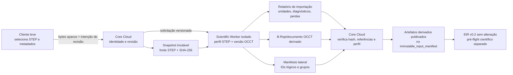

# Arquitetura futura de importação CAD STEP → OCCT

**Estado:** proposta arquitetural; não implementada e sem evidência de importação STEP/OCCT no OCRE.
**Escopo:** definir fronteiras e critérios para uma futura tradução de arquivos STEP em geometria B-Rep OCCT e artefatos de proveniência. Este documento não adiciona suporte de formato, operação, dependência, API ou campo aos contratos existentes.

## 1. Decisões fechadas

1. **Preservar a fonte:** os bytes STEP recebidos são um artefato de origem imutável. Calcular SHA-256 sobre os bytes exatos recebidos e nunca sobrescrever, normalizar, “corrigir” ou reserializar a fonte. Todo resultado OCCT é derivado, com identidade, hash e proveniência próprios. O contrato EIR v0.2 já exige hash dos bytes exatos dos artefatos consumidos e não define `revision.manifest_sha256` como substituto desse hash ([EIR_V02_CONTRACT.md](EIR_V02_CONTRACT.md#política-de-hash-e-autorização-do-pré-flight)).
2. **Executar fora do cliente:** o cliente continua leve; recebe/organiza o arquivo, mostra progresso e diagnósticos e sincroniza a revisão. A tradução de STEP e operações OCCT pesadas ficam em Scientific Worker isolado. Core Cloud mantém a autoridade sobre revisão, artefatos publicados, validação EIR e pré-flight ([INTEGRATION_ARCHITECTURE.md](INTEGRATION_ARCHITECTURE.md#1-decisão-arquitetural), [EIR_V02_CONTRACT.md](EIR_V02_CONTRACT.md#colocação-no-produto-semantica-do-eir-nao-depende-do-local-de-execucao)).
3. **Manter o contrato EIR congelado:** a importação não altera semântica, formato, versão nem campos de EIR v0.2 ou dos schemas. Metadados STEP/OCCT, mapa de correspondência e relatórios ficam em artefatos laterais versionados. `group_manifest_ref` continua sendo `artifact_id` resolvido no `immutable_input_manifest`, nunca um caminho ou nome inferido ([EIR_V02_CONTRACT.md](EIR_V02_CONTRACT.md#manifesto-do-bundle-e-grupos)).
4. **Separar importação de ciência:** “traduzido” significa somente que um perfil aceito foi lido e produziu a representação e os diagnósticos definidos pelo perfil. Não significa que a geometria represente o domínio correto, tenha materiais/grupos completos, seja fisicamente válida, esteja pronta para malha ou solver, nem que o pré-flight científico retorne `ready` ([EIR_VALIDATION_ARCHITECTURE.md](EIR_VALIDATION_ARCHITECTURE.md#objetivo-e-limite)).
5. **Não expor índices topológicos como identidade:** face/aresta/índices OCCT, números de entidade STEP e ordem de import são evidências locais da tradução, não identidade lógica persistente entre revisões. O manifesto de grupos e as referências EIR usam IDs semânticos OCRE mantidos explicitamente na revisão ([CAD_MESH_PROVENANCE_LOCAL.md](CAD_MESH_PROVENANCE_LOCAL.md#modelo-da-evidência)).
6. **Falhar de forma explícita:** conteúdo inválido, ambíguo ou fora do perfil não pode ser descartado ou “healed” silenciosamente. Reparos futuros, se habilitados, constituem uma transformação explícita, versionada e auditável, sempre sobre uma cópia derivada.

## 2. Formatos e escopo STEP

“STEP” abrange mais que uma codificação e um tipo de geometria. ISO 10303-21 define a codificação de intercâmbio em texto claro e também descreve seções para referências externas, estruturas comprimidas e assinaturas digitais ([ISO 10303-21:2016](https://www.iso.org/standard/63141.html)). A codificação ou extensão do arquivo não identifica sozinha o Application Protocol (AP), a edição, os recursos efetivamente presentes, nem a fidelidade que um tradutor consegue preservar.

| Família / perfil a considerar | Escopo relevante | Consequência para OCRE |
|---|---|---|
| AP203, ISO 10303-203 | Projeto mecânico controlado por configuração, peças e montagens; inclui representações de forma variadas, propriedades de validação e dados de apresentação, conforme a edição ([ISO 10303-203:2011](https://www.iso.org/standard/44305.html)). | Não presumir que cada arquivo seja um único sólido B-Rep. Selecionar representações aceitas e definir o que fazer com entidades adicionais. |
| AP214, ISO 10303-214 | O protocolo trata do projeto mecânico automotivo; a descrição detalhada da edição 2003 inclui peças e montagens, múltiplas representações de forma, apresentação, tolerâncias dimensionais/geométricas e propriedades ([ISO 10303-214:2003](https://www.iso.org/standard/38727.html)). A edição 2010 mantém o escopo automotivo ([ISO 10303-214:2010](https://www.iso.org/standard/43669.html)). | É uma opção legada encontrada em dados existentes; avaliar edição e compatibilidade antes de incluí-la em capability futura. |
| AP242, ISO 10303-242 | Engenharia 3D baseada em modelo; escopo amplo inclui montagens, vários tipos de geometria (incluindo B-Rep e facetada), apresentação, materiais e outros dados ([ISO 10303-242:2025](https://www.iso.org/standard/84300.html)). | Não equivale a “B-Rep simples”. Definir separadamente tratamento de geometria facetada, PMI, materiais, montagens e semântica que não será projetada. |
| STEP Part 21 edição/codificação, referências externas, arquivo compactado ou assinatura | Aspectos de transporte/codificação do exchange structure não determinam AP nem suporte de cada entidade ([ISO 10303-21:2016](https://www.iso.org/standard/63141.html)). | Um futuro perfil de ingestão deve declarar exatamente o container/codificação permitidos; não resolver conteúdo externo implicitamente nem tratar assinatura como verificação de confiança automática. |

As edições ISO 10303-203:2011 e ISO 10303-214:2010 acima são retiradas; a própria ISO aponta sucessão por AP242 para essas edições ([ISO 203:2011](https://www.iso.org/standard/44305.html), [ISO 214:2010](https://www.iso.org/standard/43669.html)). Foram incluídas como formatos que podem aparecer em arquivos legados, não como recomendação normativa vigente. A tabela usa AP242:2025 como edição publicada consultada na data desta arquitetura.

As páginas ISO identificam escopo normativo, não provam interoperabilidade de OCCT com todos os arquivos de uma AP. O tradutor OCCT oferece leitores distintos para transferência STEP genérica e integração com documento CAF; o primeiro lê/verifica e traduz entidades em modelos OCCT, enquanto o leitor CAF transfere também organização e atributos de documento ([`STEPControl_Reader`](https://occt3d.com/dev/doc/refman/html/class_s_t_e_p_control___reader.html), [`STEPCAFControl_Reader`](https://occt3d.com/dev/doc/refman/html/class_s_t_e_p_c_a_f_control___reader.html)). Essas APIs são evidência de mecanismos disponíveis no OCCT, não uma matriz de conformidade AP por entidade.

**Decisão ainda aberta:** escolher perfil(s) futuros por AP/edição, entidades permitidas e tipos de saída. Cada capability precisa nomear versões de OCCT, AP/edição/codificação, representação de forma (por exemplo, sólido manifold B-Rep), montagem, atributos opcionais e limitações. A aceitação é para esse perfil explícito, não para “qualquer STEP”. A decisão deve considerar necessidade de sólidos e seleções de grupos, não apenas a extensão `.step`/`.stp`.

## 3. Fronteiras e fluxo futuro

1. **Cliente:** seleciona o arquivo e fornece metadados/decisões que não podem ser inferidos (por exemplo, escolha de revisão e resoluções de ambiguidade). Pode gerar feedback de UX, mas não afirma importação autoritativa, validação científica ou prontidão.
2. **Core Cloud:** recebe bytes opacos, confere limites e hash, associa a fonte à revisão imutável e encaminha uma solicitação versionada. Não executa OCCT no request/API. O contrato HTTP/Cloud existente trata payloads não JSON como referências/upload opaco; não existe nele operação de importação CAD pronta ([CLOUD_API_CONTRACT.md](CLOUD_API_CONTRACT.md)).
3. **Worker:** executa leitor selecionado e versão fixada de OCCT, em isolamento operacional adequado a entrada CAD não confiável; não tem autoridade para editar a fonte, EIR ou schemas. Produz relatório e artefatos derivados, cada qual com digest e identidade de política/versão. O uso de leitor OCCT e as checagens de forma são candidatos para implementação futura, não dependências ou escolha de API fechadas neste documento.
4. **Core Cloud:** verifica os digests recebidos, versão/capability, vínculos de revisão e completude do relatório antes de registrar artefatos derivados. A validação EIR/pre-flight continua sendo fluxo distinto e somente leitura ([EIR_VALIDATION_ARCHITECTURE.md](EIR_VALIDATION_ARCHITECTURE.md#fluxo-de-validação)).

Este fluxo é proposta de arquitetura. Não define fila, broker, API, storage, autenticação/IAM ou produto cloud; tampouco declara que qualquer desses componentes esteja implantado para CAD.

## 4. Bytes, proveniência e artefatos derivados

O pacote de importação futuro deve manter pelo menos:

- artefato fonte STEP imutável, URI relativa no catálogo e SHA-256 de bytes exatos;
- perfil solicitado e perfil efetivamente reconhecido, AP/edição/codificação quando determináveis, resultado do parsing e versão/hash do tradutor OCCT;
- política/versão de unidades e tolerâncias, opções de reader e de tratamento de forma;
- artefato B-Rep/documento derivado com formato serializado, versão/formato, hash e vínculo à fonte;
- manifesto lateral de correspondência semântica e grupos, com versão e hash;
- relatório determinístico com transformações, warnings, entidades não interpretadas, perdas, ambiguidades e status final;
- hashes e relações de dependência entre todos os artefatos, sem reutilizar o hash da fonte para representar uma saída derivada.

Hashes provam igualdade de bytes conforme algoritmo declarado; não provam autoria, autenticidade, integridade de significado ou segurança do arquivo. A fonte precisa permanecer disponível para reprocessamento e comparação. O resolver do bundle usa `artifact_id` e URIs relativas confinadas segundo o contrato de artefatos v0.2; não aceita nomes como chave de identidade ([EIR_V02_CONTRACT.md](EIR_V02_CONTRACT.md#manifesto-do-bundle-e-grupos)).

## 5. Unidades, tolerâncias e alterações geométricas

### Unidades

Registrar separadamente unidade(s) declarada(s) no STEP, fatores usados no transfer, unidade de destino do B-Rep e unidade de cada quantidade EIR relevante. O OCCT tem fatores explícitos para comprimento e ângulos no processo de transferência; a API documenta unidade-alvo e fatores de comprimento/ângulo, portanto o resultado depende de configuração registrada ([`StepData_Factors`](https://occt3d.com/dev/doc/refman/html/class_step_data___factors.html)). Isso não autoriza uma unidade implícita no EIR.

Unidade omitida, desconhecida, inconsistente entre contextos, fator não finito ou escala inesperada deve gerar diagnóstico bloqueante ou pendência explícita conforme perfil. Não adivinhar unidade pela caixa delimitadora, nome, preferência de usuário ou convenção do software de origem. A preservação de valores/unidades declarados e conversão explícita/versionada na preparação seguem o contrato EIR v0.2; não reescrever EIR durante importação ([EIR_V02_CONTRACT.md](EIR_V02_CONTRACT.md#política-de-unidades)).

### Precisão e tolerâncias

Separar pelo menos: tolerâncias armazenadas em vértices/arestas/superfícies no modelo traduzido; precisão linear/angular e parâmetros de transferência; tolerância escolhida para comparação geométrica; e tolerância de qualquer transformação de reparo. Cada valor e unidade precisa de política, escopo, versão e origem registrada. Não adotar uma tolerância global “universal” nem aumentar tolerâncias para fazer o teste passar sem registrar a alteração.

O `BRepCheck_Analyzer` pode avaliar validade topológica e certas condições geométricas da forma; a própria referência descreve checagens e também casos de tolerância marcados como não implementados, então `IsValid` deve ser tratado como um gate técnico limitado, não prova universal de exatidão ou adequação científica ([`BRepCheck_Analyzer`](https://occt3d.com/dev/doc/refman/html/class_b_rep_check___analyzer.html)). Diagnóstico, healing e validação são operações distintas. Qualquer healing futuro é opt-in via política fixada; preservar original, gerar derivado novo e registrar causa, operação, parâmetros, diagnósticos antes/depois e hashes. Healing não pode mudar grupos/identidades sem invalidar ou reconciliar seus vínculos.

## 6. Geometria inválida e entidades não suportadas

O leitor deve distinguir falha de sintaxe/leitura, falha de transferência, geometria vazia, geometria B-Rep inválida, entidade não suportada, entidade reconhecida mas não projetada, e perda conhecida. Nunca interpretar “reader terminou” como conversão completa. O OCCT expõe diagnósticos de leitura/transferência e mecanismos de validação de B-Rep, úteis para classificar esses resultados ([`STEPControl_Reader`](https://occt3d.com/dev/doc/refman/html/class_s_t_e_p_control___reader.html), [`BRepCheck_Analyzer`](https://occt3d.com/dev/doc/refman/html/class_b_rep_check___analyzer.html)).

Resultado futuro deve ser um dentre:

- **`complete`**: todas as entidades obrigatórias ao perfil foram interpretadas e as verificações técnicas do perfil passaram;
- **`incomplete`**: a tradução produziu dados utilizáveis, mas há entidade/perda/ambiguidade ou reparo pendente; não liberar projeção científica que dependa da parte pendente;
- **`rejected`**: leitura, transferência ou integridade falhou, ou o conteúdo excede o perfil de forma incompatível.

O relatório aponta entidades relevantes e reason codes estáveis, sem depender apenas de mensagens livres de OCCT. Entidades ignoradas só podem ser explicitamente classificadas como não consumidas pelo perfil; se forem necessárias para geometria, montagem, grupos ou dados usados adiante, bloqueiam. Não transformar uma representação facetada em B-Rep analítico e rotular o resultado como equivalência. Se futuramente houver importação de facetada, ela recebe capability e critérios próprios.

## 7. Identidade lógica, B-Rep e projeção de grupos

Uma reimportação ou mudança de topologia pode alterar faces, arestas, fragmentação e ordem, ainda que a intenção do projeto permaneça. Assim, índices de `TopoDS_Shape`, ordinal de face/aresta, número de entidade STEP, nomes do CAD e hash geométrico isolado não são IDs persistentes suficientes. Mesmo com reader que reporte correspondência de entidade STEP para subforma traduzida, essa correspondência vale para a tradução/documento corrente; não prova estabilidade entre revisões ([`STEPControl_Reader`](https://occt3d.com/dev/doc/refman/html/class_s_t_e_p_control___reader.html)).

O modelo futuro separa:

- **identidade semântica OCRE:** `geometry_id`/IDs de grupos opacos, únicos na revisão EIR e mantidos por decisão/mapeamento explícito;
- **alvo geométrico da revisão:** referência local à B-Rep, rótulos de documento OCCT ou descritor de subformas, com escopo restrito ao hash e à versão daquela importação;
- **proveniência de correspondência:** relação entre ID semântico, fonte/revisão, evidência de resolução, regra/versão de mapeamento e subformas derivadas.

Os nomes/labels da estrutura CAF podem auxiliar na navegação de assembly e apresentação, mas não são identidade semântica garantida; por isso devem ser evidência ou sugestão para o usuário, nunca vínculo inferido sem validação ([`STEPCAFControl_Reader`](https://occt3d.com/dev/doc/refman/html/class_s_t_e_p_c_a_f_control___reader.html)). Correspondência automática só é aceitável quando houver regra determinística versionada, evidência suficiente e teste de estabilidade para o perfil. Match múltiplo, ausente ou ambíguo deixa o mapeamento pendente e exige reconciliação explícita; não remapear carga, restrição ou material por proximidade geométrica silenciosa.

A projeção futura para EIR/manifesto ocorre fora do parser:

1. Criar ou atualizar IDs semânticos na revisão por mapeamento explícito; cada região homogênea exigida pelo perfil mantém `geometry_id` estável conforme EIR v0.2.
2. Escrever grupos semânticos e sua evidência no manifesto de grupos lateral versionado. O manifesto referencia a revisão/caso/geometria e, quando aplicável, hash da malha conforme o contrato vigente.
3. Catalogar source STEP, B-Rep derivada, relatório e manifesto como artifacts distintos no `immutable_input_manifest`; ligar `group_manifest_ref` ao `artifact_id` do manifesto. Não criar campo novo em EIR nem resolver grupo por path/nome.
4. Submeter o EIR existente à validação estrutural/semântica e pré-flight independentes. Região sem atribuição/material requerido, grupo ausente ou referência incompatível permanece bloqueada, mesmo que importação B-Rep esteja completa.

## 8. Limite entre importação e validação científica

| Gate | Evidência que pode produzir | O que não conclui |
|---|---|---|
| Integridade da entrada | Bytes disponíveis, SHA-256 correspondente, referência ao snapshot e limites de leitura cumpridos. | Confiança no autor, validade do STEP ou validade física. |
| Tradução STEP → OCCT | Perfil/capability aceitos, relatório de entidades, B-Rep/documento derivado e diagnósticos OCCT. | Equivalência sem perdas com CAD nativo ou validade do domínio científico. |
| Checagem de B-Rep | Critérios técnicos de topologia/parametrização definidos e avaliados pelo perfil. | Unicidade de material/região, completude de grupos/BCs, adequação de engenharia ou qualidade de malha. |
| Projeção EIR/manifests | IDs/referências explícitos e hashes resolvíveis sob contratos atuais. | `ready` sem executar o pré-flight definido pelo perfil. |
| Validação científica e pré-flight | Apenas regras determinísticas do EIR/perfil e capacidades configuradas; autoridade prevista no Core Cloud. | Garantia universal de segurança, precisão física, convergência ou validade do produto real. |

Importação, B-Rep válida e sucesso de projeção não mudam o status de execução. `ready` continua pertencendo ao pré-flight autoritativo e só permite o fluxo subsequente definido pelo perfil; importação STEP não chama solver, não cria evidência de convergência e não eleva status científico.

## 9. Fixtures, testes e aceitação futura

Esta entrega não inclui fixtures, testes executáveis ou arquivos STEP. Quando a implementação for autorizada, preparar uma suíte versionada de **fixtures sintéticas controladas** por perfil. Cada fixture terá licença/origem, bytes/hash, codificação/AP/edição, unidades, entidade/capacidade sob teste e resultado esperado. Não apresentar fixture sintética como evidência de compatibilidade com CAD de produção.

| Grupo de teste | Fixtures/casos futuros | Invariante de aceitação |
|---|---|---|
| Formato e perfil | Amostras mínimas válidas dos APs/edições explicitamente habilitados; AP ou entidade fora do perfil; Part 21 truncado, arquivo vazio e codificação/container não aceito. | Aceitar apenas escopo nomeado; rejeições e incompletudes têm diagnóstico determinístico; nenhuma entidade obrigatória some silenciosamente. |
| Forma e assemblies | Sólido/compound B-Rep conhecido, múltiplas peças/instâncias, representação facetada quando fora do perfil, forma vazia e casos B-Rep inválidos controlados. | Contagens/estrutura de saída correspondem ao contrato da fixture; `complete` exige as checagens técnicas do perfil. |
| Unidades e precisão | Unidade conhecida, ausente, conversão de comprimento/ângulo, contextos conflitantes, valores extremos e tolerâncias de fronteira. | Unidade/origem/fator/alvo e policy estão registrados; conversões explícitas e reproduzíveis; nenhuma inferência ou ajuste silencioso. |
| Entidades/perdas/reparo | Entidade não suportada, entidade reconhecida mas não projetada, falha de transferência, healing desabilitado/habilitado em policy própria. | Status separa completo/incompleto/rejeitado; todo reparo produz artefato e relatório derivados, sem alterar bytes de origem. |
| Integridade | SHA-256 conhecido, arquivo truncado/trocado após staging, tentativa de escrita no artefato original. | Hash corresponde aos bytes exatos do snapshot consumido; alterações são detectadas; fonte permanece imutável durante o pipeline. |
| Identidade e grupos | Reimportação idêntica, alteração de ordem/IDs de origem, subdivisão/união topológica e caso de correspondência ambígua. | IDs semânticos não derivam de ordinais OCCT/STEP; regra persistente passa testes conhecidos; ambiguidade bloqueia os grupos que dependem dela. |
| EIR/manifesto | Golden fixtures e digests dos três schemas congelados v0.2; referência a manifesto por `artifact_id`; hash divergente ou ausente. | Nenhum campo/semântica/schema EIR muda; refs e hashes resolvem conforme v0.2; erros de import não viram `ready`. |
| Fronteira do produto | Testes de contrato com cliente leve, Core Cloud e fake/local worker sem serviço cloud/broker. | Cliente não declara prontidão; worker recebe snapshot imutável; Core verifica resultado; nenhum sucesso de import isolado libera execução científica. |

**Critério de aceitação do slice futuro:** cada capability declara AP/edição/codificação e versão OCCT; fixtures cobrem exatamente esse escopo; mesmos bytes, versões e política produzem resumos e diagnósticos esperados; source hash e imutabilidade são verificados; B-Rep tem status explícito; entidades/perdas/tolerâncias são contabilizadas; IDs/grupos são estáveis para os casos aprovados ou ficam pendentes; EIR v0.2 e schema-lock continuam intactos; execução permanece bloqueada até os gates científicos independentes passarem. Fixtures não bastam para afirmar interoperabilidade real: antes de marcar capability de produção como validada, exigir corpus autorizado e evidência representativa com proveniência, hash, versões e revisão humana apropriada.

## 10. Opções abertas, riscos e handoff

| Decisão futura | Opções a avaliar | Risco se fechada sem evidência |
|---|---|---|
| AP/edição/codificação inicial | Perfil estreito B-Rep, AP203/AP214/AP242 em perfis separados; Part 21 texto, extensão/arquivo compactado ou referências externas explicitamente permitidos. | Prometer “suporte STEP” indistinto que mascara lacunas de entidades e perdas. |
| Leitor OCCT | Leitor STEP genérico vs leitor CAF/XDE quando árvore de assembly/atributos for necessária. | Perda de estrutura/metadados ou maior superfície de incompatibilidade; os leitores têm responsabilidades diferentes ([`STEPControl_Reader`](https://occt3d.com/dev/doc/refman/html/class_s_t_e_p_control___reader.html), [`STEPCAFControl_Reader`](https://occt3d.com/dev/doc/refman/html/class_s_t_e_p_c_a_f_control___reader.html)). |
| Perfil de unidade | Unidade destino linear/angular, tratamento de unidades ausentes/conflitantes e conversões autorizadas. | Escala errada pode produzir geometria plausível e resultados científicos sem sentido. |
| Critérios e healing | Critérios de validade, análise exata/aproximada, permitir ou não reparo, valores limite e aprovação de alteração. | Reparo pode alterar domínio, tolerâncias, grupos ou identidade sem que usuário perceba. |
| Identidade persistente | Seleção explícita pelo usuário, IDs fornecidos por origem, regras geométricas versionadas ou combinações com confirmação. | Falso match atribui cargas/material a faces/regiões erradas; heurística sem evidência compromete proveniência. |
| Formato do B-Rep derivado | Formato nativo OCCT versus representação/serialização de intercâmbio interna controlada, com política de compatibilidade. | Não reprodutibilidade entre versão do tradutor, formato ou ambiente; dependência indevida de detalhes binários internos. |
| Limites do worker | Tamanho, tempo, memória, quantidade de entidades, concorrência, arquivos externos, política de rede e sandbox. | STEP não confiável pode esgotar recursos, explorar parser ou escapar do isolamento operacional. |

**Handoff:** antes de implementar, um responsável de arquitetura deve aprovar o perfil inicial e os critérios de fidelidade; engenharia deve fixar/avaliar versão, componentes e configuração OCCT e a política de isolamento do worker; responsável científico deve definir regiões/grupos e condições de identidade necessárias ao perfil; engenharia/teste deve produzir fixtures e corpus autorizado, critérios de perdas e teste de reimport/topologia; Core deve confirmar como artefatos derivados entram no manifesto e passam pelo pré-flight existente. Nenhuma dessas aprovações é concedida por este documento.

**Riscos residuais:** os padrões AP são amplos; o apoio real de um tradutor varia por edição, entidade, opções e arquivo. Hash e reader bem-sucedido não medem fidelidade. Identidade topológica persistente geral não é prometida. Política de healing/unidades e limites operacionais permanecem abertas. A arquitetura não é evidência de implementação, segurança certificada ou suporte comercial.

## Revisões integradas

- **Arquitetura:** separou IDs semânticos da topologia OCCT; posicionou tradução em worker e projeção fora do parser; manteve EIR imutável.
- **Engenharia:** confirmou fronteiras com contratos de bundle, hash, preparação e worker. Identificadores de face, entity numbers ou hashes geométricos crus não sustentam identidade entre revisões.
- **Teste:** definiu matriz de fixtures sintéticas, hashes, unidades, geometria inválida, entidades fora do perfil, estabilidade de IDs, projeção e não promoção a `ready`. Fixtures/testes foram adiados conforme escopo desta entrega documental.
- **Crítica adversarial:** não encontrou bloqueios; pediu explicitar que as edições 203:2011 e 214:2010 estão retiradas. Essa ressalva foi integrada.
- **Verificação independente:** confirmou cobertura do escopo e fontes oficiais; pediu fonte mais direta para detalhes AP214. A linha passou a citar a edição 2003 para o escopo detalhado e 2010 apenas para o domínio automotivo; revisão final confirmou a correção.
