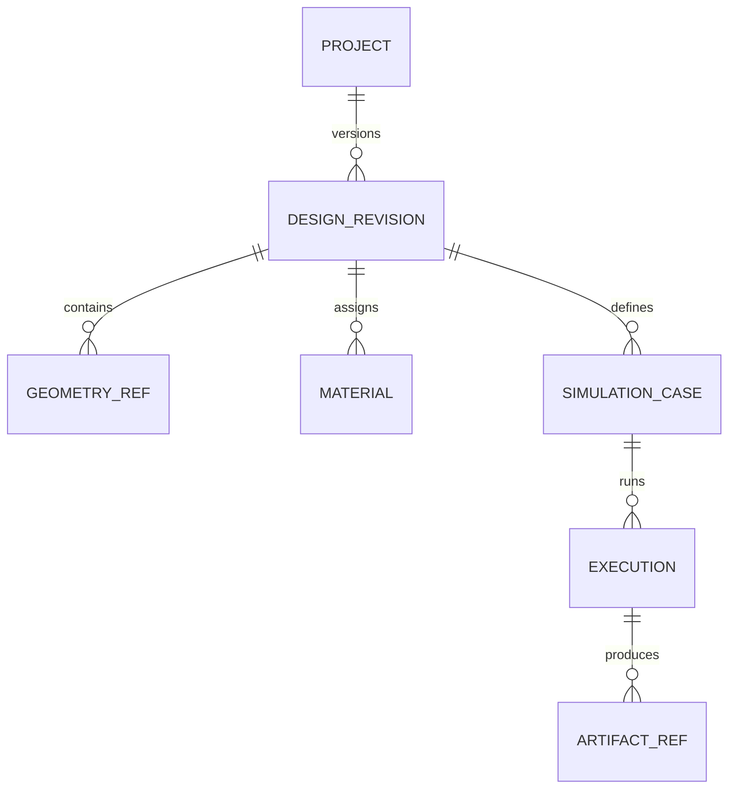

# EIR mínimo — primeira versão de trabalho

**Estado:** EIR v0.1 é uma proposta experimental legada e imutável; seus JSON Schemas continuam em [schemas/eir/0.1.0.schema.json](../../schemas/eir/0.1.0.schema.json) e [schemas/eir/mesh-group-manifest-0.1.0.schema.json](../../schemas/eir/mesh-group-manifest-0.1.0.schema.json). O contrato vigente v0.2 está congelado em [EIR_V02_CONTRACT.md](EIR_V02_CONTRACT.md), com três schemas versionados. Nenhuma versão ainda tem validador semântico de produção; o pré-flight autoritativo do produto será executado no Core Cloud.

## Escopo

Representar somente o necessário para identificar uma revisão de projeto e vincular o caso estrutural axial aos artefatos de entrada e resultado. Parâmetros, coordenadas dos pinos, métricas e gates normativos deste benchmark são definidos em [STRUCTURAL_REFERENCE_CASE.md](STRUCTURAL_REFERENCE_CASE.md) e [STRUCTURAL_VALIDATION_ARCHITECTURE.md](STRUCTURAL_VALIDATION_ARCHITECTURE.md); este EIR define como referenciá-los, sem copiá-los. Arquivos CAD, malha e solver permanecem em seus formatos nativos. O EIR armazena semântica comum e referências com hash; não tenta converter histórico CAD ou todos os tipos de física para uma ontologia universal.

## Entidades e relações



| Entidade | Identidade | Campos essenciais |
| --- | --- | --- |
| `Project` | `project_id` estável | nome, `eir_schema_version`, sistema de unidades padrão |
| `DesignRevision` | `revision_id` imutável | `project_id`, hash do manifesto, pais, data, referências de geometria |
| `GeometryRef` | `geometry_id` na revisão | URI de artefato, hash, formato/versão, unidade, referencial, bounding box opcional |
| `Material` | `material_id` na revisão | propriedades tipadas com unidade, modelo constitutivo e proveniência |
| `SimulationCase` | `case_id` | revisão exata, domínio/análise, solver pretendido, inputs e condições tipadas |
| `Execution` | `execution_id` | caso/hash de entrada, adaptador e versões, estado, timestamps e saída |
| `ArtifactRef` | `artifact_id` | papel, URI, hash, MIME/format, unidade/referencial se aplicável, relatório de conversão |

Identificadores são opacos e estáveis; hashes de artefatos são SHA-256 sobre bytes exatos. Alterar conteúdo cria revisão/caso/execução novos. `parent_revision_ids` expressa linhagem, não mutação retroativa. O algoritmo e a versão de canonicalização para hash de revisão permanecem em aberto; por isso `manifest_sha256` pode ser `null` enquanto não resolvido. O schema aceita `null` ou um digest SHA-256 hexadecimal de 64 caracteres, mas isso não define uma serialização canônica interoperável.

## Regras de unidade e referencial

- Toda quantidade física é `{ "value": número, "unit": símbolo UCUM }`; dimensões sem unidade precisam ser explicitamente adimensionais.
- O caso declara um referencial destro, origem, eixos, unidade de comprimento e transformação para o referencial da geometria. A convenção da barra é registrada no caso, não inferida do solver.
- Não aceitar conversão silenciosa, unidade ausente ou coordenada implícita. Conversões e transformações são registradas no relatório de preparação.
- IDs de grupos de contorno são nomes semânticos persistidos no manifesto derivado; tags numéricas de uma malha são locais ao artefato e não constituem identidade global. Para este caso, o manifesto mapeia cada ID semântico à origem geométrica, coordenada de referência quando aplicável, conjunto nodal/elementar no artefato de destino, contagens esperada/observada e hash da malha. A forma serializada desse manifesto ainda é proposta, não schema executável.

## Exemplo ilustrativo

```json
{
  "eir_schema_version": "0.1.0",
  "project": {"project_id": "prj_demo"},
  "revision": {
    "revision_id": "rev_tension_bar_001",
    "project_id": "prj_demo",
    "parent_revision_ids": [],
    "manifest_sha256": null
  },
  "geometry": [{
    "geometry_id": "geom_tension_bar",
    "artifact": {"uri": "artifacts/tension_bar.step", "sha256": null, "format": "STEP", "format_version": "AP242"},
    "length_unit": "mm",
    "frame_id": "frame_tension_bar"
  }],
  "materials": [{
    "material_id": "steel_linear_elastic",
    "model": "linear_elastic_isotropic",
    "properties": {
      "young_modulus": {"value": 210000, "unit": "N/mm2"},
      "poisson_ratio": {"value": 0.3, "unit": "1"}
    }
  }],
  "simulation_cases": [{
    "case_id": "case_tension_bar_v1",
    "revision_id": "rev_tension_bar_001",
    "domain": "structural",
    "analysis": "static_linear",
    "frame_id": "frame_tension_bar",
    "groups": ["VOLUME", "X_FIXED", "X_DISPLACED", "PIN_A", "PIN_B"],
    "group_manifest_ref": "artifact_group_manifest",
    "loads": [],
    "constraints": [
      {"group": "X_FIXED", "kind": "displacement", "components": {"x": {"value": 0, "unit": "mm"}}},
      {"group": "X_DISPLACED", "kind": "displacement", "components": {"x": {"value": 0.01, "unit": "mm"}}},
      {"selection_ref": "PIN_A", "kind": "displacement", "components": {"y": {"value": 0, "unit": "mm"}, "z": {"value": 0, "unit": "mm"}}},
      {"selection_ref": "PIN_B", "kind": "displacement", "components": {"z": {"value": 0, "unit": "mm"}}}
    ],
    "solver": {"adapter_id": "calculix.batch", "proposed_target_version": "2.23"}
  }]
}
```

O exemplo é ilustrativo; seus shapes não são contrato persistido congelado. `PIN_A` e `PIN_B` são referências semânticas a seleções, não node sets nem apelidos de nós. Para cada seleção, o manifesto referenciado registra `semantic_id`, referência da entidade geométrica, seletor, referência à coordenada definida no caso canônico, hash/revisão da malha, conjunto de destino, IDs de nós resolvidos e checagem das coordenadas/tolerância aplicada. Não converter a referência em node set do solver sem registrar e validar essa resolução. O benchmark sintético local exercitou essas restrições em coordenadas reproduzíveis e observou as deformações laterais esperadas; a validação automática deste schema cobre somente estrutura/tipos, não relações entre IDs nem proveniência desde CAD.

## Integridade e proveniência

O manifesto de revisão enumera bytes, papéis, hashes, software que os gerou e relações entre geometria original e derivados. Uma execução registra hash completo do pacote de entrada, manifestos, imagens/ambiente, parâmetros, seed se aplicável e hashes dos outputs. Ausência de proveniência impede declarar resultado reproduzível. Até definir canonicalização, o hash da revisão está explicitamente pendente; o schema v0.1 não define a serialização canônica.

URIs dentro do bundle são caminhos relativos normalizados à raiz do bundle. Rejeitar caminhos absolutos, `..`, escapes após resolver symlinks, separadores ambíguos e qualquer arquivo fora da raiz do bundle. A regra é requisito do contrato; JSON Schema não comprova confinamento após resolução de symlinks, portanto essa checagem permanece responsabilidade da aplicação.

## Escopo de validação do schema v0.1

O schema valida campos, tipos, identificadores simples, quantidades com unidade declarada e a forma do caso axial de referência. O schema do manifesto de grupos valida a forma dos mapeamentos de origem/destino, contagens e coordenadas resolvidas. Ambos são experimentais e identificados pela versão `0.1.0`.

Não validam que referências apontem para IDs existentes, que `group_manifest_ref` resolva a um artefato declarado, que unidades sejam semanticamente válidas em UCUM, que URIs permaneçam dentro do bundle, que coordenadas correspondam à geometria ou que os hashes sejam reproduzíveis. O manifesto completo de execução do harness é evidência experimental e não é instância deste EIR ou do schema de grupos.

## Fora do primeiro schema

Montagens complexas, topologia persistente de kernel, permissões/usuários, sincronização concorrente, co-simulação, resultados de campo normalizados, FMI e telemetria industrial. Esses itens ficam em artefatos ou extensões versionadas até haver um caso de uso concreto.
