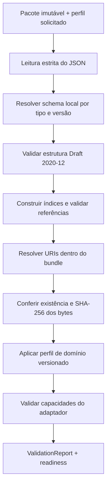

# Arquitetura do validador determinístico do EIR

**Estado:** arquitetura implementada parcialmente no Core local. Há validação estrutural/semântica EIR v0.2, codificador puro local para OCRE-AF/1 e migrador explícito v0.1→draft v0.2. O codificador ainda não está ligado ao conjunto completo de insumos do pré-flight; execução continua bloqueada com `approval_fingerprint_unavailable`. Drafts de migração nunca liberam aprovação ou execução. Isto não declara disponibilidade no Core Cloud.

## Objetivo e limite

Definir uma validação repetível no Core Cloud antes de `prepare`/`submit`, que identifique erros estruturais, referências quebradas e artefatos inconsistentes no pacote de engenharia. Este pré-flight é a autoridade que pode liberar o despacho aos Scientific Workers. O cliente pode oferecer avisos offline, mas não declarar prontidão de execução. O validador não executa solver, não altera o projeto e não declara que um modelo é seguro ou fisicamente válido.

Os JSON Schemas Draft 2020-12 em [`schemas/eir`](../../schemas/eir/README.md) formam a camada estrutural do contrato v0.2; a implementação local já acrescenta parsing estrito, validação semântica e verificações de integridade de pacote. O manifesto `solver_runs_manifest.json` da prova é evidência experimental local; ele não é instância do EIR nem do manifesto de grupos.

## Situação atual do contrato

O Core Python local já contém o validador em `backend/ocre_core/validation/validator.py`, com parsing JSON estrito, validação Draft 2020-12, referências, regras do perfil axial, manifesto de grupos e confinamento/hash de artefatos. A API FastAPI local está implementada e coberta por testes locais. Sua operação no Core Cloud continua pendente, sem IAM real, broker ou worker real. A rota de pré-flight de execução verifica capacidades fornecidas, mas reporta `approval_fingerprint_unavailable`; o serviço força `execution_readiness: blocked` e não cria job enquanto o conjunto completo de entradas verificadas de OCRE-AF/1 não estiver integrado. A integração é implementação local, não serviço cloud implantado. O código científico continua isolado no harness experimental em `experiments/fea-reference/run_reference.py`.

O EIR v0.1 legado não representa algumas relações necessárias a uma verificação completa; essas lacunas de representação foram tratadas pelo contrato v0.2 congelado. A implementação v0.2 local verifica parte dessas relações; o codificador normativo de OCRE-AF/1 existe localmente, mas sua integração e os insumos verificados no pré-flight, além dos gates completos de capacidade e validação física, seguem pendentes:

- `group_manifest_ref` é uma string, sem inventário de artefatos interno que permita resolver o ID;
- `frame_id` aparece sem entidade ou catálogo de referenciais;
- o caso não aponta explicitamente para a geometria usada nem para os materiais atribuídos;
- a política para hashes `null` não distingue rascunho de pacote pronto para execução;
- a canonicalização do hash de revisão continua em aberto.

O validador não deve inferir vínculos que o contrato não define. No pré-flight de execução, as relações exigidas pelo perfil precisam estar resolvidas; lacunas bloqueiam a prontidão em vez de serem preenchidas por heurística.

O contrato aprovado e congelado está em [EIR_V02_CONTRACT.md](EIR_V02_CONTRACT.md). Ele fixa quaternion, política UCUM, fingerprint `OCRE-AF/1`, migração explícita e fronteira de versão; os três schemas v0.2 estão travados por digest em [`schemas/eir`](../../schemas/eir/README.md). A implementação local valida estrutura e semântica sem alterar contrato ou schemas. O módulo `approval_fingerprint.py` implementa o codificador/framing normativo e tem testes locais, mas o validador/serviço ainda não obtém/verifica o conjunto completo das entradas e reporta `approval_fingerprint_unavailable`; por isso o pré-flight não libera execução. O migrador explícito produz um artefato separado em `draft`, preserva os bytes originais e registra resoluções e pendências; não é uma via de aprovação. No produto, a autoridade prevista é o Core Cloud antes do despacho aos Scientific Workers; não há alegação de implantação cloud.

## Fluxo de validação



Se uma etapa obrigatória falhar, as seguintes que dependem dela não executam. Por exemplo, erros de parsing ou schema impedem resolução semântica; URI insegura impede abrir o artefato. Cada etapa continua emitindo seus diagnósticos independentes quando isso não exigir interpretar dados inválidos.

### 1. Entrada estrita

- Receber documento EIR, manifesto de bundle e manifesto de grupos como bytes/documentos identificados; impor limites de tamanho configurados.
- Rejeitar JSON inválido, chaves duplicadas e números não finitos, em vez de aceitar comportamento divergente entre parsers.
- Resolver schemas somente de um registro local aprovado por `(document_kind, schema_version)`. Não baixar schemas, `$ref` ou artefatos da rede durante a validação.
- Registrar os hashes dos schemas usados e a versão do perfil de validação.

### 2. Validação estrutural

- A implementação local seleciona Draft 2020-12 e fornece `FormatChecker` explícito, incluindo checagem RFC 3339 para `date-time`. A dependência declarada é `jsonschema==4.26.0` em `backend/requirements.txt`; a versão instalada depende do ambiente (4.10.3 no Python 3 consultado nesta atualização). Ver [JSON Schema 2020-12 — Validation](https://json-schema.org/draft/2020-12/json-schema-validation).
- Não interpretar sucesso estrutural como coerência do projeto, integridade do bundle ou aprovação de engenharia.

### 3. Índice semântico e referências

Construir índices por namespace de identidade, detectar IDs duplicados e conferir somente relações que o EIR define. No mínimo, o perfil v0.2 deverá permitir verificar:

- `project.project_id` corresponde a `revision.project_id`;
- cada `revision_id`, `geometry_id`, `material_id`, `case_id`, `frame_id`, `semantic_id` e `artifact_id` referenciado existe no escopo correto;
- cada caso pertence à revisão selecionada e declara geometria, materiais e manifesto de grupos aplicáveis;
- todos os grupos usados em cargas/restrições existem no manifesto, e as identidades de caso, revisão, geometria e malha concordam entre EIR e manifestos.

O EIR v0.2 representa frame, atribuição material, geometria por caso e resolução de `group_manifest_ref` no catálogo do bundle. A implementação verifica essas relações e bloqueia referências ausentes; não cria relações implícitas com base em nomes de arquivo ou em existir um único caso.

### 4. Resolução segura do bundle e integridade

O resolver de artefatos recebe a raiz do bundle e uma URI relativa. Sua interface não expõe caminho absoluto da máquina aos relatórios. O contrato de URI deverá definir uma gramática única para eliminar interpretações divergentes entre plataformas. Para v0.2, recomenda-se aceitar somente caminhos relativos POSIX normalizados, sem esquema, autoridade, query, fragmento, caminho absoluto, `.`/`..`, barra invertida, NUL ou separador codificado ambíguo.

Depois da resolução:

- exigir que o alvo exista como arquivo regular e permaneça dentro da raiz canônica, inclusive após resolver links simbólicos;
- conferir SHA-256 sobre os bytes efetivamente lidos. `sha256: null` pode ser permitido no perfil de edição, mas bloqueia o perfil de execução;
- não considerar a checagem do caminho uma garantia contra alteração concorrente. Antes de execução, o orquestrador deve criar/receber um snapshot imutável de entrada, re-hash dos bytes staged e passar exatamente esse snapshot ao adapter.
- tratar erro de acesso, link quebrado, hash divergente e URI inválida como diagnósticos distintos.

A validação é somente leitura. Ela não limpa, reescreve, move ou re-hasha arquivos de origem.

### 5. Perfil de domínio

Aplicar regras determinísticas por perfil versionado, sem embutir “regras universais” no JSON Schema. O perfil `structural.axial_bar.v1`, ligado ao caso canônico em [`STRUCTURAL_REFERENCE_CASE.md`](STRUCTURAL_REFERENCE_CASE.md), está implementado localmente para relações EIR, propriedades suportadas, unidades UCUM da allowlist, condições aceitas e consistência de grupos/contagens.

A implementação local aplica a allowlist UCUM versionada do perfil axial e rejeita unidades fora dela; não executa conversões nem comprova geometria física. Conferência de coordenadas contra sólido, topologia, qualidade geral de malha e suporte completo do solver continuam sob gates posteriores de preparação/conversão.

### 6. Capacidades do adapter

No perfil de execução, a implementação local confere declarações fornecidas para suporte, domínio, análise, versão alvo e tipo/ordem de elemento quando disponíveis. Essa cobertura não constitui o gate completo de capacidades: formato, plataforma, licença/configuração e demais requisitos ainda precisam ser integrados. Uma incompatibilidade ou declaração ausente bloqueia prontidão. O validador não chama solver; a aplicação rejeita submissão bloqueada antes de persistir job/evento/outbox, conforme teste de serviço local.

## Interface lógica

```text
validate(eir, bundle, group_manifest=None, *, bundle_root=None, purpose="authoring", ...)
    -> ValidationReport
```

Esta assinatura Python é a implementação local atual em `backend/ocre_core/validation/validator.py`; a decomposição em `SchemaRegistry`, `BundleReader` e demais portas abaixo continua sendo a forma lógica pretendida para evolução.

Campos conceituais de `request`:

- documento EIR e manifestos fornecidos;
- raiz/identidade do bundle;
- `purpose`: `authoring` ou `execution_preflight`;
- perfil de domínio e de capacidade selecionados;
- limites de leitura aplicáveis.

Dependências entram por interfaces (`SchemaRegistry`, `BundleReader`, `UnitRegistry`, `AdapterCapabilities`) para manter o validador desacoplado dos detalhes de armazenamento e dos adaptadores. O baseline inicial de implementação é Python, conforme ADR-007; isso não escolhe uma biblioteca específica nem altera o contrato EIR. O validador de schema deve suportar Draft 2020-12 e ter comportamento de formatos testado e fixado.

## Relatório de validação

`ValidationReport` é determinístico e inclui:

- versão do relatório, tipo/versão do schema, perfil e versão da política;
- status geral: `valid`, `invalid` ou `incomplete`;
- `execution_readiness`: `ready` ou `blocked` para `execution_preflight`, ou `not_requested` para revisão de autoria;
- resultados separados por etapa (`passed`, `warning`, `failed`, `not_assessed`);
- lista ordenada de diagnósticos, cada qual com `code` estável, `stage`, `severity`, JSON Pointer relativo, mensagem para usuário e ID semântico/artefato associado quando aplicável.

Os diagnósticos devem ter ordenação estável (etapa, JSON Pointer, código), não incluir caminhos absolutos nem dados sensíveis. Códigos iniciais possíveis: `EIR_PARSE_ERROR`, `EIR_SCHEMA_UNSUPPORTED`, `EIR_SCHEMA_INVALID`, `EIR_DUPLICATE_ID`, `EIR_REFERENCE_NOT_FOUND`, `BUNDLE_URI_INVALID`, `BUNDLE_PATH_ESCAPE`, `ARTIFACT_NOT_FOUND`, `ARTIFACT_HASH_PENDING`, `ARTIFACT_HASH_MISMATCH`, `UNIT_UNKNOWN`, `UNIT_DIMENSION_MISMATCH`, `GROUP_COUNT_MISMATCH`, `ADAPTER_CAPABILITY_UNSUPPORTED` e `CASE_INPUT_INCOMPLETE`.

`valid` significa apenas que todas as verificações requeridas pelo perfil solicitado passaram. Não é um status de segurança, certificação, convergência ou validação física. Uma entrada estruturalmente válida, mas com hash pendente ou relações ausentes, deve ser `incomplete` para pré-flight, não `valid`.

## Matriz mínima de aceitação

| Camada | Deve aceitar | Deve rejeitar ou marcar incompleto |
| --- | --- | --- |
| Parsing | JSON UTF-8 válido com chaves únicas | JSON truncado, chaves repetidas, NaN/Infinity, documento acima do limite |
| Schema | Amostra EIR e manifestos válidos sob versão registrada | Versão desconhecida, campos/tipos inválidos, estruturas incompletas |
| Referências | IDs existentes e relações de revisão/caso consistentes | IDs duplicados/inexistentes, caso em revisão errada, grupo/manifesto de outro caso |
| Bundle | URI relativa interna, arquivo presente e SHA-256 correspondente | Caminho absoluto, `..`, escape por symlink, arquivo ausente, hash divergente |
| Prontidão | Hash presente e referências completas em `execution_preflight` | Hash `null`, material/frame/artefato exigido não resolvido |
| Domínio | Caso axial coerente com o perfil versionado | Unidade incompatível, coordenadas/tolerância inconsistentes, limites de material inválidos para o perfil |
| Adapter | Capacidades compatíveis, sem criar execução | Solver/formato/elemento/versão fora das capacidades declaradas |
| Determinismo | Mesmo input, schemas e perfil geram relatório igual e ordenado | Diagnósticos que dependem da ordem de map, caminho local ou variável de ambiente não registrada |

Os testes locais cobrem parsing/schema/semântica, leitura limitada, bundle/hash, determinismo e a rejeição da submissão bloqueada sem gravação de job/evento/outbox. Testes separados verificam codificação/framing OCRE-AF/1 e migração para draft com pendências. Ainda falta exercitar os gates junto a um adapter executável integrado e infraestrutura real; os testes atuais não demonstram despacho nem execução de solver.

## Estado e próxima sequência

1. **Integrar OCRE-AF/1 ao pré-flight** com obtenção e verificação de todas as entradas obrigatórias, golden vectors interoperáveis e bloqueio em qualquer ausência/divergência; o codificador local, por si só, não libera execução.
2. **Completar a validação do draft migrado** com bundle/resoluções e verificar relatório/pendências de ponta a ponta. Migração permanece explícita e nunca aprova nem executa.
3. **Fechar lacunas de domínio e capacidade:** ampliar cobertura física para o uso pretendido e completar a verificação das capacidades exigidas pelo adapter.
4. **Integrar e operar no Core Cloud:** autenticação/autorização reais e implantação; conectar banco, fila/broker, serviços externos e workers reais, preservando SQLite/outbox como evidência apenas local.
5. **Ampliar validação física e proveniência**, incluindo CAD importado e critérios de qualidade de malha adequados ao uso pretendido.

## Decisões ainda abertas

- especificação de URI do bundle e defesa contra links simbólicos/TOCTOU por plataforma;
- expansão do catálogo/perfis UCUM além da allowlist axial atualmente implementada;
- política de tamanho máximo de JSON, bundle e artefatos;
- semântica do modo `authoring` em campos incompletos versus `execution_preflight`;
- cobertura ponta a ponta da migração v0.1→v0.2 com bundle, resoluções e verificação de pendências;
- integração dos insumos verificados de `OCRE-AF/1` no fluxo de aplicação e golden vectors interoperáveis;
- cobertura física mais ampla, capacidades completas de adapter e execução do fluxo no Core Cloud com autenticação real, banco, broker e worker reais;
- regras físicas e limiares do perfil axial, sem extrapolar para validação geral.

## Agentes consultados

Arquitetura, mapeamento do repositório e matriz de aceitação foram revisados anteriormente por agentes `architect`, `explore` e `test-engineer`. O código atual implementa parte dessa arquitetura localmente; os limites acima impedem declarar pré-flight liberador de execução ou runtime cloud completo.
