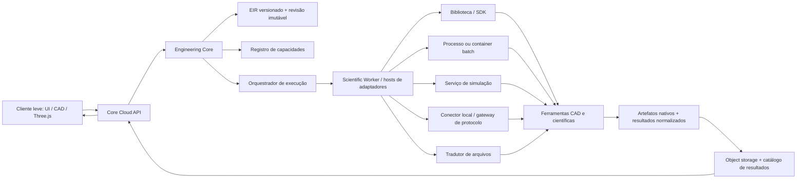

# Arquitetura de integração de ferramentas

**Estado:** direção híbrida de produto aprovada; arquitetura detalhada e integrações ainda não implementadas.
**Conclusão da viabilidade:** sim, os softwares citados podem ser coordenados por uma plataforma OCRE. Isso não significa incorporá-los todos no mesmo processo, oferecer paridade completa entre eles ou redistribuir seus binários.

## 1. Decisão arquitetural

“Um só lugar” significa que o usuário gerencia projetos, versões, permissões, execuções e resultados pela mesma plataforma. O produto padrão é híbrido: cliente leve para interface e trabalho interativo, Core Cloud e Scientific Workers para validação autoritativa e motores científicos. Execução local avançada é uma opção futura; nenhum motor pesado é requisito de instalação para o usuário.

OCRE será um **plano de controle e integração**, não um superprocesso que carrega todos os motores. O Engineering Core coordena contratos comuns; adaptadores implementam mecanismos específicos. Nenhuma conversão será considerada fiel apenas porque terminou sem erro.

### O que será comum

- Identidade de projeto e revisão imutável.
- Unidades, referenciais e proveniência explícitos.
- Envelope de caso, execução, estado, eventos e resultado.
- Registro de capacidades e limitações por adaptador/versão.
- Armazenamento e visualização de artefatos versionados.

### O que permanece específico

- Histórico paramétrico e semântica nativa de cada CAD.
- Tipos de elemento, comandos, modelos constitutivos, malhas e opções de cada solver.
- APIs, bibliotecas, runtimes, hardware e licenças exigidas por cada software.
- Protocolos temporais de simulação ao vivo e formatos de telemetria.

O **EIR** deve ser uma representação interna versionada e extensível, não um formato universal que apaga os dados nativos. Cada projeto preserva arquivos de origem, pacotes nativos e metadados específicos junto das projeções normalizadas que a plataforma sabe interpretar.

### Colocação aprovada dos componentes

- **Cliente leve:** UI, Three.js, visualização e interação CAD, operações geométricas leves, cache local e sincronização de projetos/revisões. Pode dar feedback local, mas não marca execução como pronta.
- **Core Cloud:** identidade/projetos/revisões, validador EIR e pré-flight autoritativos, orquestração de jobs, catálogo e storage de artefatos, eventos e pós-processamento.
- **Scientific Workers:** execução isolada de OCCT complexo, Gmsh, CalculiX, OpenFOAM, Isaac Sim/Newton e demais motores habilitados por perfil/licença/capacidade.
- **Máquina do usuário:** não instala nem executa solver ou outro motor pesado no fluxo padrão. A execução local avançada poderá existir como opção posterior e explícita. A prova Gmsh/CalculiX em `experiments/fea-reference/` é somente evidência experimental do ambiente de desenvolvimento.

## 2. Arquitetura lógica



## 3. Componentes e responsabilidades

1. **Cliente OCRE:** CAD interativo leve/preview, Three.js, cache e sincronização local; apresenta casos, progresso, avisos de conversão e resultados. Não inicia comandos livres enviados pela IA e não é autoridade de pré-flight.
2. **Core Cloud / Engineering Core:** projetos, revisões, permissões, validação EIR, pré-flight, metadados, unidades/referenciais, proveniência e associação entre modelo, execução e resultado.
3. **EIR e catálogo de artefatos:** schemas versionados para conceitos comuns; arquivos originais, entradas específicas de solver, malhas, logs e resultados permanecem em object storage com hashes e manifestos.
4. **Registro de capacidades:** manifesto de cada adaptador e versão: domínios, operações, formatos, sistemas operacionais, modos (`batch`, `session`, `stream`), requisitos de CPU/GPU/memória, limitações, maturidade, política de licença e disponibilidade local/cloud.
5. **Orquestrador:** confere se o adaptador realmente atende ao caso, seleciona colocação e recursos, cria um job/session rastreável, emite eventos, aplica quotas e apresenta resultado ou falha. A seleção começa por regras explícitas; otimização de custo/latência é evolução posterior.
6. **Scientific Worker / Host de adaptadores:** executa cada integração pesada isolada segundo sua modalidade. Solvers e arquivos de projeto devem ser tratados como entrada potencialmente não confiável: sandbox, limites de recursos, isolamento de rede e diretórios temporários por execução.
7. **Conectores de borda:** processos locais para ferramentas que exigem desktop, hardware, instalação ou licença do usuário; gateways separados para ROS 2, OPC UA, MQTT ou outros sistemas operacionais.
8. **Camada de resultados:** mantém o resultado nativo e, quando houver mapeamento validado, produz campos normalizados para busca/visualização. Cada conversão registra aviso e `LossReport`.

## 4. Tipos de adaptador

Todos expõem um envelope de controle comum, mas o mecanismo de execução varia:

| Tipo | Uso adequado | Exemplos candidatos |
| --- | --- | --- |
| Biblioteca/SDK | API embutível, chamada síncrona ou acesso direto ao modelo | OCCT; ngspice; MuJoCo; SimPy; algumas APIs do Gmsh/SUMO |
| Processo/CLI em worker | Ferramenta batch com arquivos de entrada/saída; isolamento e pin de ambiente | Gmsh; CalculiX; Code_Aster; Elmer; OpenFOAM; SU2; FreeCADCmd; Blender em background; ParaView `pvbatch`; comandos autorizados de Abaqus/Ansys |
| Serviço/sessão de longa duração | Simulação interativa, cliente-servidor, GPU ou troca repetida de estado | Isaac Sim; Gazebo; `pvserver`; SUMO via TraCI; runtimes de co-simulação |
| Tradutor de arquivo | Importação/exportação assíncrona sem execução direta do motor | STEP/IGES, MSH/MED/INP, FRD/VTK/VTU, USD, URDF, MJCF, FMU |
| Conector local/gateway | Dependência de software, dispositivo ou licença instalada no cliente; telemetria industrial | KiCad IPC quando exigir instância local; licenças comerciais; ROS 2; OPC UA; MQTT |

Os tipos podem ser combinados. No produto padrão, adaptadores de importação/preparação e solver executam em workers cloud e devolvem artefatos/resultados ao Core Cloud. Conector ou executor local é exceção opcional futura para instalações autorizadas; não muda o padrão nem exige motores no cliente.

## 5. Contrato de adaptador

Contrato conceitual para todos os adaptadores:

```text
describe_capabilities() -> CapabilityManifest
validate(request, input_manifest) -> ValidationReport
prepare(request, immutable_revision) -> InputBundle + ConversionReport
submit(InputBundle, idempotency_key) -> ExecutionRef
get_status(ExecutionRef) -> State + Progress + Events
cancel(ExecutionRef) -> CancellationReport
collect(ExecutionRef) -> ResultManifest + NativeArtifacts + Logs
cleanup(ExecutionRef) -> CleanupReport
```

Para `session` e `stream`, acrescentar um contrato tipado de inicialização, avanço/troca de variáveis e encerramento. Não fingir que o ciclo por polling de um job batch serve para co-simulação em tempo real ou telemetria contínua.

Cada `CapabilityManifest` deve registrar, no mínimo:

- nome/ID do adaptador, versão, versão e hash do software externo;
- versão de schema do request e dos resultados;
- formatos de geometria, malha, dados e resultados aceitos;
- tipos de problema, recursos e funcionalidades realmente suportados;
- requisitos de ambiente, sistema operacional, CPU/GPU, memória e rede;
- requisitos e escopo da licença: local, servidor de licença, comercial, livre ou revisão pendente;
- limitações conhecidas, proveniência de validação e maturidade (`experimental`, `validated` etc.).

## 6. Contratos de dados e rastreabilidade

O pacote de entrada de cada execução deve conter:

- `project_id`, `design_revision_id` e hash da revisão;
- caso de análise com schema/versionamento, unidades e referencial;
- referências a geometria original e representações derivadas;
- materiais, montagem, condições de contorno e parâmetros de domínio necessários;
- arquivos gerados pelo tradutor e seu manifesto de hashes;
- versão/configuração do adaptador, software e imagem/ambiente de execução.

O manifesto de resultado associa cada arquivo a unidade, referencial, malha, variável, componente, ponto/elemento e revisão de origem, quando aplicável. Se um campo não puder ser normalizado com segurança, o produto oferece o resultado nativo e marca essa limitação.

O `ConversionReport` deve registrar formatos/versões de origem e destino, transformações, IDs/grupos mapeados, avisos, elementos descartados e propriedades sem correspondência. O `LossReport` precisa distinguir perda conhecida, dado não interpretado e conversão rejeitada.

Resultados só podem ser reutilizados quando a chave de cache incluir inputs imutáveis, versões e configurações de ferramenta/adaptador e ambiente relevante. Mudanças em geometria, materiais, malha, condições ou solver criam novo caso/execução ou invalidam a reutilização.

## 7. Ciclo de execução

### Jobs batch

`created → validated → queued → preparing → running → collecting → succeeded | failed | cancelled`.

Jobs possuem `idempotency_key`, prazo, limites de recurso, tentativas explicitamente classificadas, código de falha, logs e artifacts. Repetição só é automática quando a operação for segura e a causa classificada como transitória. Cancelamento não publica resultado parcial como válido.

### Sessões e streams

Simulação interativa e aquisição de dados possuem ciclo distinto: `starting → active → stopping → closed | failed`. São necessários heartbeat, política de reconexão, sequence/time stamps, backpressure, descarte/armazenamento de dados e limites de latência. Esses casos não usam retry cego de job.

### Co-simulação

É uma capacidade de workflow/adapter que declara os motores compatíveis, portas e variáveis, unidades, causalidade, relógio, passo de comunicação, interpolação, tolerância/convergência e política de erro. FMI suporta modalidades diferentes — Model Exchange, Co-Simulation e Scheduled Execution — mas não transforma qualquer par de executáveis em simuladores acopláveis. Execução sequencial deve ser implementada antes do acoplamento temporal.

## 8. Integração dos softwares citados

As classificações indicam o mecanismo a avaliar, não uma integração OCRE já pronta. “Licenciada” significa que a automação, execução cloud e redistribuição precisam ser confirmadas para o SKU/versão escolhido.

| Família | Ferramentas | Caminho de integração | Restrição/próxima verificação |
| --- | --- | --- | --- |
| CAD e geometria | OCCT, OpenCascade.js, FreeCAD | Biblioteca C++; WASM; Python/FreeCADCmd; STEP/IGES | Não presumir paridade de versão ou API entre C++ e WASM; preservar árvore paramétrica separada da geometria de intercâmbio. |
| Malha e estrutural | Gmsh, CalculiX, Code_Aster, Elmer | API/CLI + arquivos MSH/INP/MED/FRD e processos batch | Testar conectividade, tipos de elemento, orientação, grupos físicos, materiais, unidades, cargas/BCs e resultados por versão. |
| Comercial estrutural | ANSYS Mechanical, Abaqus | APIs/scripts e processo autorizado, potencialmente worker/conector | Integração depende de SKU, licença, servidor de licença, limites de automação/cloud e termos de redistribuição. Não prometer worker cloud antes de validação comercial. |
| Visualização científica | ParaView | `pvpython`/`pvbatch`, `pvserver` remoto, VTK | É pós-processamento/visualização, não solver; manter resultado original e usar formatos VTK só onde o mapeamento for validado. |
| Robótica | Isaac Sim, Newton, MuJoCo, Gazebo, ROS 2, Isaac Lab | APIs Python/C++; extensões; headless/containers; ROS 2; USD/URDF/MJCF | Serviços de GPU e sessões longas são diferentes de jobs batch. Newton/Isaac e bridges ROS/Gazebo são dependentes de versão e tipos suportados. |
| Treino robótico | PyTorch, RL Games, RSL-RL, Stable-Baselines3 | Bibliotecas em worker de treino + checkpoints/versionamento | Capturar versão do simulador, seed, política, dataset e configuração; controlar custo GPU e validar sim-to-real. |
| CFD/térmica | OpenFOAM, SU2, Elmer | CLI/processos batch em workers CPU/GPU + formatos de malha/resultado | Criar adapter por solver e validar modelos de turbulência, condições, convergência e pós-processamento; formatos comuns não igualam semântica. |
| Eletrônica e controle | OpenModelica, ngspice, KiCad, FMI/FMU | CLI/API, biblioteca ngspice, FMU, IPC API ou `kicad-cli` conforme versão | FMI liga componentes compatíveis; versões do KiCad têm diferentes capacidades headless/IPC. Respeitar o fluxo próprio de projeto/PCB. |
| Simulação industrial | SimPy, SUMO, AnyLogic, Factory I/O, Tecnomatix | Biblioteca, TraCI/libsumo, export Java/cloud ou driver/protocolo | São produtos de modalidades distintas; APIs, edição e execução remota podem exigir edição/licença comercial. Tecnomatix requer confirmação específica de produto/API. |
| Gêmeos digitais | OPC UA, MQTT, REST; PLC/SCADA/MES/ERP | Conectores/gateways de protocolo e APIs | Separar ingestão de telemetria de solver; definir esquema de payload, timestamps, unidades, identidade do equipamento, certificados e política de reconexão. |
| Modelagem visual | Blender, Three.js, OpenUSD | Python/background; biblioteca JS no cliente; formato USD | Blender é processo/ ferramenta visual; Three.js é visualização cliente; USD transporta cenas, mas não substitui histórico paramétrico ou contratos de solver. |

Exemplos de evidência oficial consultada: [Gmsh manual/API](https://gmsh.info/doc/texinfo/), [CalculiX 2.23 manual](https://www.dhondt.de/ccx_2.23.pdf), [Code_Aster execução](https://code-aster.org/doc/v17/manuals/man_u/u1/u1.04.00/notions_generales.html), [Abaqus `noGUI`](https://docs.software.vt.edu/abaqusv2025/English/SIMACAECAERefMap/simacae-c-gststart.htm), [Ansys ACT](https://ansyshelp.ansys.com/public/Views/Secured/corp/v242/en/act_dev/act_dev_ACT_API.html), [ParaView](https://docs.paraview.org/en/latest/UsersGuide/introduction.html), [Isaac Sim ROS 2](https://docs.isaacsim.omniverse.nvidia.com/6.2.0/ros2_tutorials/overview/ros2_reference_architecture.html), [Newton FAQ](https://newton-physics.github.io/newton/stable/faq.html), [Gazebo ROS bridge](https://gazebosim.org/docs/harmonic/ros2_integration/), [MuJoCo APIs](https://mujoco.readthedocs.io/en/stable/overview.html), [OpenUSD](https://openusd.org/release/), [OpenModelica](https://openmodelica.org/doc/OpenModelicaUsersGuide/OpenModelicaUsersGuide-latest.pdf), [FMI 3.0.2](https://fmi-standard.org/docs/3.0.2/), [ngspice shared library](https://ngspice.sourceforge.io/shared.html), [KiCad IPC API](https://dev-docs.kicad.org/en/apis-and-binding/ipc-api/for-addon-developers/), [SUMO TraCI/libsumo](https://sumo.dlr.de/userdoc/TraCI/), [SimPy](https://simpy.readthedocs.io/en/stable/), [AnyLogic export](https://anylogic.help/anylogic/running/export-java-application.html), [Factory I/O OPC UA](https://docs.factoryio.com/manual/drivers/opc/), [OPC UA](https://reference.opcfoundation.org/specs/OPC-10000-1/full), [SU2](https://su2code.github.io/docs_v7/Execution/) e [OpenCascade.js](https://github.com/donalffons/opencascade.js).

## 9. Licenças, segurança e operação

- Cada adaptador precisa de uma política de distribuição/executação aprovada por versão e modo de implantação. Código aberto não implica automaticamente que qualquer empacotamento ou combinação esteja liberado; software comercial requer autorização/licença por ambiente.
- Armazenar credenciais de servidor de licenças em cofre, nunca no EIR, prompt ou log. O worker recebe credenciais efêmeras por identidade de serviço.
- Executar conteúdo de projeto e solvers em sandbox com identidade sem privilégios, filesystem por job, quotas, imagem fixada, rede negada por padrão e trilha de auditoria.
- Conectores industriais permanecem em uma fronteira de rede controlada, com certificado/identidade, allowlist, schema e aprovação de operação. Escrita em PLC/SCADA fica desabilitada por padrão e exige autorização explícita do produto.
- Separar tenants, projeto, fila, armazenamento, compute e secrets; definir retenção, exclusão e residência dos artefatos antes de cloud de produção.

## 10. Fases de implementação

1. **Contratos do núcleo:** EIR v0.2 congelado, manifestos de capacidade, ciclo de job, bundle de entrada/resultado, hashes e relatórios de conversão.
2. **Core Cloud + primeiro Scientific Worker:** pré-flight cloud, fila/persistência, storage de artefatos, isolamento, progresso, cancelamento, retries classificados e primeiro adaptador estrutural cloud.
3. **Cliente leve:** UI/Three.js/CAD interativo, cache e sincronização com revisões imutáveis e conflitos explícitos.
4. **Prova local existente:** Gmsh/CalculiX local permanece benchmark experimental de desenvolvimento, não modo de produto nem requisito do usuário.
5. **Integrações de domínio:** adicionar adaptadores um a um, após prova técnica, licença e critérios de validação do seu domínio.
6. **Sessões e protocolos:** ROS 2, telemetria OPC UA/MQTT, simulação interativa e co-simulação como produtos de execução distintos.

## 11. Critérios para declarar uma integração suportada

Uma ferramenta só é “suportada” quando uma combinação específica de adaptador, versão, plataforma e modalidade tem:

1. licença/distribuição avaliadas;
2. manifesto de capacidades e limitações;
3. instalação reproduzível e execução/versões pinadas;
4. conversão testada com fixtures e relatório de perda;
5. unidades, coordenadas, IDs/grupos e campos validados;
6. fluxo de falha, cancelamento, recuperação e logs verificado;
7. caso de referência científico ou funcional aprovado;
8. limites de recursos/segurança e suporte de versão publicados.

### Conclusão

A visão de **Engineering Core + EIR + adaptadores + workers** está bem direcionada para reunir os softwares em uma experiência única. A arquitetura só fica pronta para implementação depois de especificar o EIR mínimo, manifests, estados de execução, perda de conversão, permissões/licenças e como provar cada adapter. Integração produto-wide é possível; interoperabilidade sem perda e execução cloud universal não devem ser prometidas.
